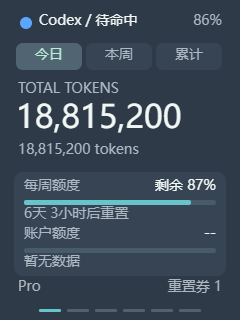
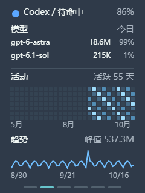
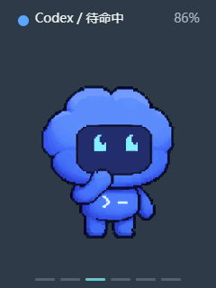
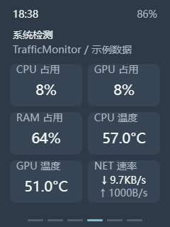
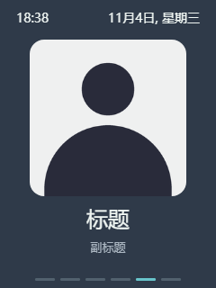

<strong>EN</strong> | <a href="README.zh_CN.md">CN</a>

  <picture>
    <source media="(prefers-color-scheme: dark)" srcset="docs/brand-dark.svg">
    
  </picture>

<h1 align="center">Tokens Kanban&nbsp;</h1>

<em>A live Codex usage, quota, and activity display for FoloToy AI Passport.</em>

  
  
  
  
  

  

## Showcase

<table align="center">
  <tr>
    <td align="center" width="33%"> <strong>Usage Overview</strong></td>
    <td align="center" width="33%"> <strong>Analytics</strong></td>
    <td align="center" width="33%"> <strong>Virtual Pet</strong></td>
  </tr>
  <tr>
    <td align="center" width="33%"> <strong>System Monitor</strong></td>
    <td align="center" width="33%"> <strong>Postcard</strong></td>
    <td align="center" width="33%"> <strong>Fullscreen Wallpaper</strong></td>
  </tr>
</table>

## Features

- View Codex token usage, model breakdowns, activity trends, and account limits. Cost estimates use API pricing and are separate from subscription charges.
- Customize page order, themes, wallpaper, postcards, and the startup logo. The virtual pet reflects Codex activity.
- Display Windows system metrics with the optional TrafficMonitor 1.86 x64 bridge.

## Get started

1. Download and extract the sync package for your operating system from the [latest release](https://github.com/GreentailTohru-arch/Tokens-Kanban/releases/latest).
2. Run the launcher and select **1** to start syncing. On Windows, use `start.cmd`. On macOS, use `start.command` with Python 3.10 or later. The first macOS launch needs internet access to install dependencies. See the [macOS setup guide](firmware/docs/macos-companion.md).
3. Connect the AI Passport by USB or Bluetooth Low Energy. Use the [Device Manager](https://greentailtohru-arch.github.io/Tokens-Kanban/) to preview and configure the display.

Double-press **OK** for the next page and triple-press it for the previous page. On the usage and analytics pages, press **Up** or **Down** to change the time range. Hold either button to adjust volume.

## Firmware

- **Update an existing installation.** Stop desktop sync, connect by USB, and open **About & Updates → Check for updates → Install update** in the Device Manager using desktop Chrome or Edge. If prompted for a file, select the application image ending in `-app.bin`.
- **Install from scratch.** Flash the image ending in `-full.bin` at `0x0` with an ESP32-C3 flashing tool. A full flash can reset saved settings.

## Development

Firmware and the desktop companion live in [firmware/](firmware/). The Device Manager has a [GitHub Pages copy](docs/) and a [bundled copy](firmware/companion/postcard/). Keep both in sync when changing the web UI.

Set up [ESP-IDF 5.5.3](firmware/docs/development/engineering/environment-setup.md), then run `./tools/validate.sh` from `firmware/` to build and validate the firmware. See the [build and test guide](firmware/docs/development/engineering/build-and-test.md) and [changelog](docs/changelog/CHANGELOG.md).

Based on [FoloToy AI Passport](https://github.com/FoloToy/ai-passport). Licensed under [MIT](LICENSE).
