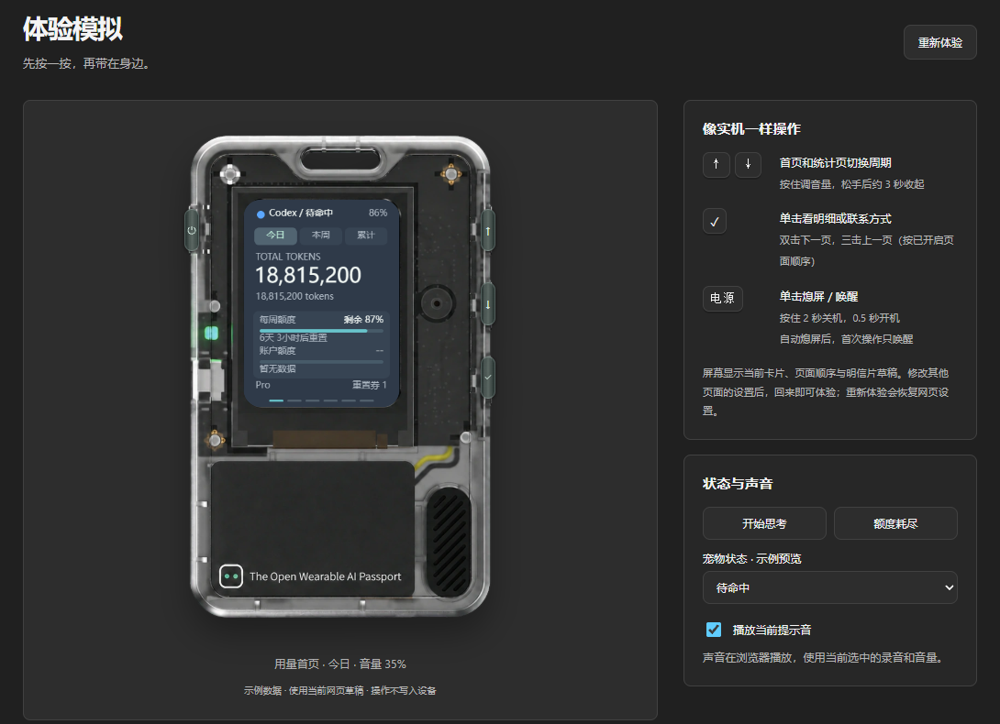

<a href="README.md">EN</a> | <strong>CN</strong>

  <picture>
    <source media="(prefers-color-scheme: dark)" srcset="docs/brand-dark.svg">
    
  </picture>

<h1 align="center">Tokens Kanban&nbsp;</h1>

<em>在 FoloToy AI Passport 上实时查看 Codex 用量、额度和运行状态。</em>

  
  
  
  
  

  

  

## 主要功能

- **Codex 用量**：查看 Token 数、模型与活动趋势、额度和按 API 单价估算的费用。统计来自电脑可读取的本地历史，估算费用与订阅账单分开。
- **虚拟宠物**：提供在线、思考、额度不足三套动画。未连接时显示独立文案，复用额度不足动画。
- **个性化显示**：配置设备页面顺序、主题、壁纸、明信片和开机 Logo。
- **系统检测**：Windows 可通过独立的 TrafficMonitor 1.86 x64 桥接插件显示支持的系统指标。

## 快速开始

| 使用场景 | 操作 |
| --- | --- |
| Windows 同步 | 完整解压 Windows 同步包，运行 `start.cmd`，选 **1** 启动同步。选 **2** 开启登录自启，选 **4** 停止同步。 |
| macOS 同步 | 完整解压 macOS 同步包，使用 Python 3.10 或以上版本运行 `start.command`。首次启动需要联网安装依赖。 |
| 管理或预览设备 | 打开管理网页，在「页面管理」中选择设备上显示的页面和顺序。 |
| 更新已有固件 | 先停止同步并通过 USB 连接设备，再用桌面版 Chrome 或 Edge 打开管理网页，选择「关于与更新 → 安装更新」。 |
| 首次完整安装 | 使用支持 ESP32-C3 的刷写工具，将完整镜像写入 `0x0`。此操作可能重置已保存的设置。 |

同步程序支持 USB 和低功耗蓝牙。网页升级器使用应用镜像（`app.bin`）写入 `0x10000`，并核验目标分区和镜像校验值。两种固件、同步包和 SHA-256 校验文件均可从最新版 Release 下载。

在设备上双击 OK 前进一页，三击 OK 返回一页。用量首页和统计页可短按上下键切换周期，长按上下键调节音量。

## 仓库结构

| 路径 | 内容 |
| --- | --- |
| [`firmware/`](firmware/) | ESP-IDF 5.5.3 固件、电脑同步程序、构建工具及主机测试 |
| [`docs/`](docs/) | GitHub Pages 网页及[版本历史](docs/changelog/CHANGELOG.zh_CN.md) |
| [`update.json`](update.json) | 管理网页从发布标签读取的固件升级清单 |

同步程序也可在本机启动管理网页，源码位于 [`firmware/companion/postcard/`](firmware/companion/postcard/)。修改网页时，应同步更新 GitHub Pages 与电脑包使用的源码。构建固件前请按 [ESP-IDF 环境指南](firmware/docs/development/engineering/environment-setup.zh_CN.md)配置工具链，再进入 `firmware/` 运行 `./tools/validate.sh`。具体流程见[构建与测试说明](firmware/docs/development/engineering/build-and-test.zh_CN.md)。

已发布固件通过构建和主机测试。v33 已刷入 AI Passport，并通过 USB 读回版本确认。Windows 同步包的内置网页已验证，macOS 运行仍待实测。

项目基于 [FoloToy AI Passport](https://github.com/FoloToy/ai-passport)，采用 [MIT 许可证](LICENSE)。
